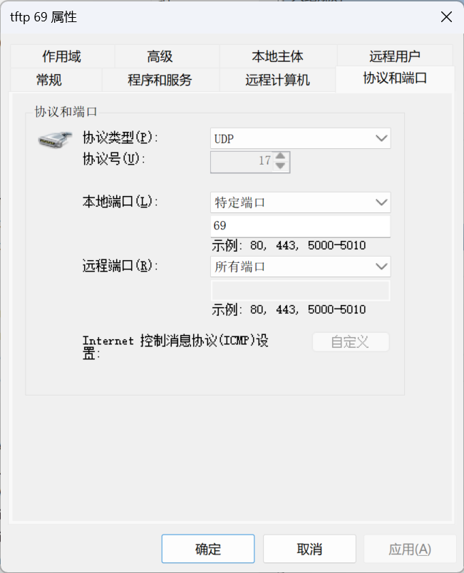

# 上传tftp

## 1.Debian安装tftp

```bash
apt update
apt install tftpd-hpa tftp-hpa
```

## 2.配置tftp

```bash
# 配置tftp
sudo vim /etc/default/tftpd-hpa
# 修改以下内容
TFTP_USERNAME="tftp"
TFTP_DIRECTORY="/var/lib/tftpboot"
TFTP_ADDRESS="0.0.0.0:69"
TFTP_OPTIONS="--secure"
```

## 3.重启tftp

```bash
sudo systemctl restart tftpd-hpa
```

## 4.在 AR1200 的 V200R003C00 上传

```bash
<Huawei>tftp 192.168.1.100
<Huawei-tftp> put vrpcfg.zip
```

## windows开端口

- 图片：