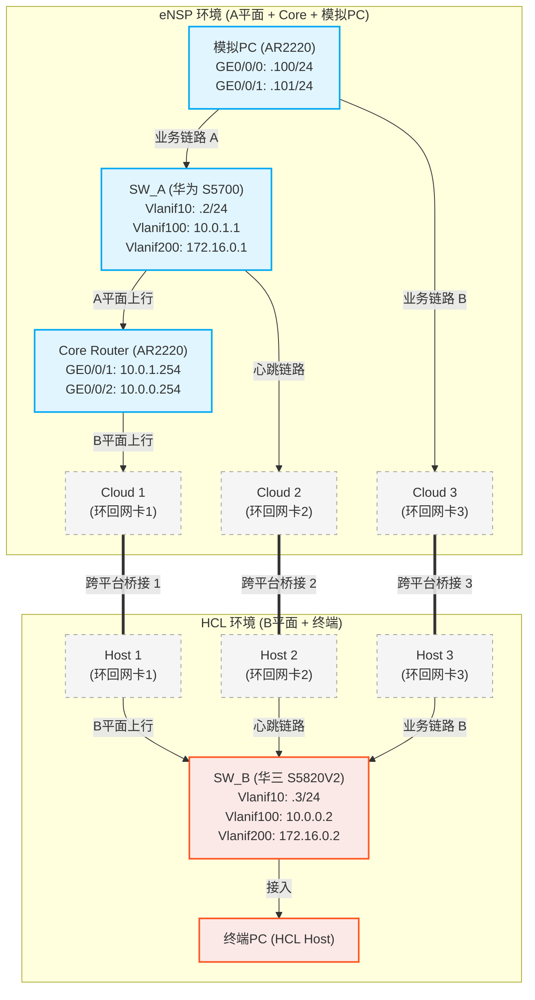
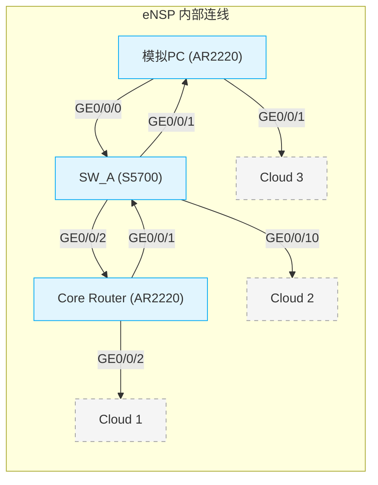
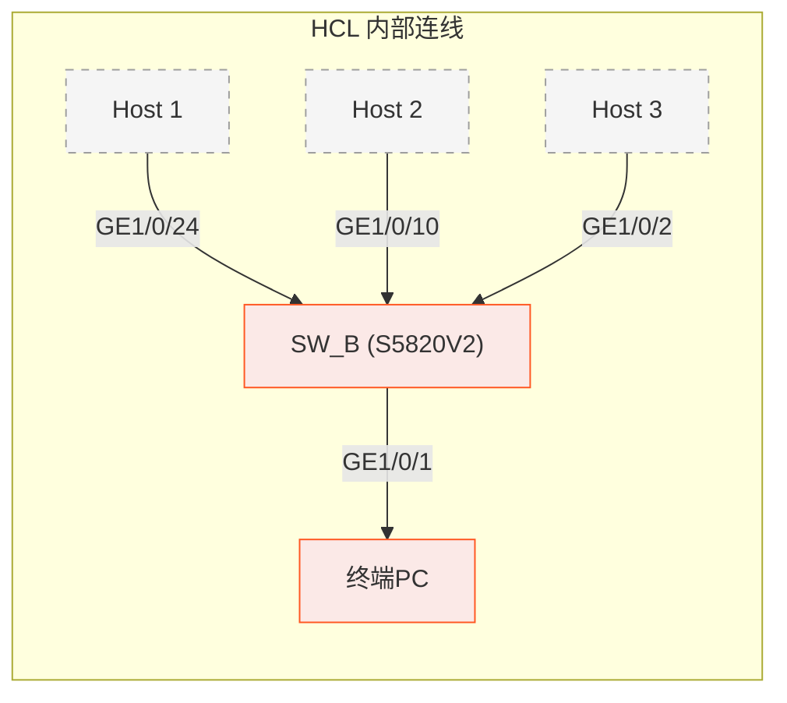

使用 Markdown 的 Mermaid 绘图语法，可以清晰地展示这种跨模拟器的复杂拓扑。由于 Mermaid 不支持在同一个图里嵌套多层子图，我将拓扑分为**全局拓扑总览**、**eNSP 内部**、**HCL 内部**三个部分来画，这样结构最清晰。

### 1. 全局拓扑总览（跨平台视角）

这张图展示了所有设备的逻辑连接关系，以及跨平台桥接的对应位置。

---

### 2. eNSP 内部连线细节（物理端口视角）

这张图详细展示了在 eNSP 软件内部，设备之间是如何通过网线连接的。

---

### 3. HCL 内部连线细节（物理端口视角）

这张图详细展示了在 HCL 软件内部，设备与 Host 之间的连线关系。

---

### 💡 拓扑图阅读提示

1. **实线**代表模拟器内部的真实连线（虚拟网线）。
2. **粗虚线**（`===`）代表跨平台的逻辑桥接，它们必须绑定到宿主机上**同一块**环回网卡（如 `Microsoft KM-TEST 环回适配器`）。
3. **环回网卡 1**：负责打通 `Core Router` 和 `SW_B`，让 B 平面有上行出口。
4. **环回网卡 2**：负责打通 `SW_A` 和 `SW_B`，让 VRRP 和 BFD 能够互相通信进行主备选举。
5. **环回网卡 3**：负责打通 `模拟PC` 和 `SW_B`，实现终端真正的双上联，用于演示终端侧的自动路由切换。