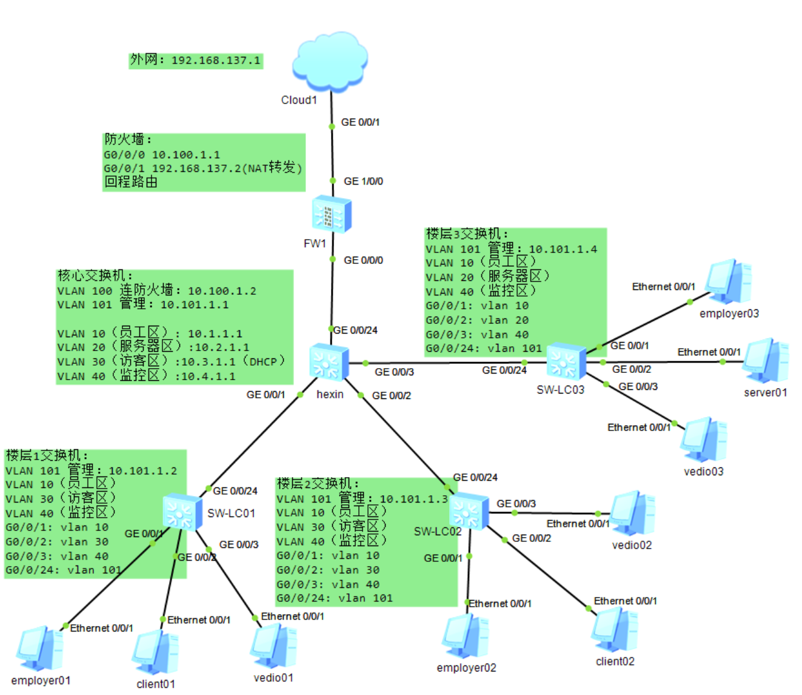

# 解决问题过程

## 问题1

- 想添加规则：服务器可以连通外网，测试通过，需要在防火墙禁止服务器访问外网，需要的时候开通某个IP，如何配置
- 图片：

---

在防火墙（FW1）上，要通过**安全策略**来实现“默认禁止服务器区访问外网，仅按需放行特定IP”。核心思路是：先配置一条优先级高的禁止策略，覆盖服务器区（VLAN 20 网段）所有对外访问；再配置一条允许策略，精确匹配需要上网的某个IP，并置于禁止策略之前。由于安全策略是按顺序从上往下匹配的，先匹配到的策略会生效，所以必须确保允许特定IP的策略排在禁止策略的上方。

### 🛠️ 配置步骤（CLI命令行方式）

假设你的服务器区网段为 `10.2.1.0/24`，需要放行的特定服务器IP为 `10.2.1.100`，以下命令在防火墙 FW1 上配置。

1.  **配置精确的允许策略**：这条策略用于“开通某个IP”，需要匹配特定源IP访问外网。执行以下命令：
    ```bash
    system-view
    security-policy
    rule name Allow_Specific_Server
     source-zone trust
     destination-zone untrust
     source-address 10.2.1.100 32  # 替换为你需要开通的实际服务器IP
     action permit
     quit
    ```
    这条规则会精确匹配 `10.2.1.100` 发出的流量，并允许其通过防火墙。

2.  **配置宽泛的禁止策略**：这条策略用于“禁止服务器访问外网”，需要覆盖整个服务器区网段，但必须放在允许策略的**下方**。
    ```bash
    security-policy
    rule name Deny_Server_Internet
     source-zone trust
     destination-zone untrust
     source-address 10.2.1.0 24  # 匹配整个服务器区网段
     action deny
     quit
    ```
    由于策略是从上往下匹配的，`10.2.1.100` 的流量会先命中第一条允许策略，而其他服务器（如 `10.2.1.101`）的流量则会继续向下，命中第二条禁止策略。

> **说明**：你可以在 `source-address` 中直接使用 `10.2.1.100 32` 表示单个主机；如果需要放行多个不连续的IP，建议先创建地址集（`ip address-set`）进行统一管理，再在策略中引用。

### 💡 关键注意事项

*   **策略顺序是核心**：在安全策略列表中，`Allow_Specific_Server` 必须位于 `Deny_Server_Internet` 的上方。如果顺序反了，所有服务器的流量会先被禁止策略拦截，允许策略永远不会生效。
*   **NAT 策略不需要改动**：你的拓扑中，服务器访问外网需要做NAT转换（源NAT）。安全策略控制的是“是否允许流量通过”，NAT策略控制的是“源IP如何转换”。只要NAT策略正常配置，放行特定IP后，它依然能正常上网。
*   **验证与检查**：配置完成后，可以在防火墙上使用 `display security-policy rule all` 查看策略顺序和命中计数。如果测试不通，先确认策略顺序，再检查 `10.2.1.100` 的网关和路由是否正确。

如果你更习惯用图形界面（Web）配置，可以在“策略 > 安全策略”中，通过“新建”并拖动调整位置来实现同样的逻辑。需要我帮你梳理 Web 界面的具体操作位置吗？

---

## 问题2

```text
[FW1-policy-security-rule-deny_server_internet]di this
2026-11-18 06:02:44.670 
#
 rule name deny_server_internet
  source-zone trust
  destination-zone untrust
  source-address 10.2.1.0 mask 255.255.255.0
  action deny
#
return  加了限制，但似乎没用，服务器仍然可以ping 1.1.1.1
```

---

你观察到的现象很典型：命令确实加上了，但没生效。从你贴出的配置看，**策略本身写对了**，问题出在**安全策略的匹配顺序**或者**流量根本没走到这条策略**上。下面按可能性从高到低帮你排查。

### 🔍 1. 检查策略顺序（最常见原因）

防火墙安全策略是**从上往下逐条匹配，命中即停**。如果你之前已经存在一条允许服务器上网的策略（比如通用的 `trust` 到 `untrust` 放行策略，或者NAT相关的放行策略），它排在 `deny_server_internet` **上方**，那么流量会先命中那条允许策略，根本不会走到你的禁止策略。

**检查命令：**
```bash
display security-policy rule all
```
查看输出中 `deny_server_internet` 前面是否还有 `source-zone trust` 到 `destination-zone untrust` 且 `action permit` 的规则。如果有，你需要：

- **方案A**：把 `deny_server_internet` 移到那条允许策略**上方**。
- **方案B**：如果那条允许策略范围太宽（比如放行了整个 `10.0.0.0/8`），直接修改它，把服务器网段 `10.2.1.0/24` 排除掉，或者删除那条通用放行策略，改为按区域精细化放行。

如果确实要调整顺序，CLI 下可以用 `rule move` 命令，例如：
```bash
security-policy
rule move deny_server_internet before <允许策略的rule name>
```

### 🔍 2. 确认防火墙是否在做NAT（源NAT会让策略匹配异常）

你的拓扑里防火墙 `G0/0/1` 是 `192.168.137.2(NAT转发)`。如果服务器 `ping 1.1.1.1` 的流量在防火墙上先做了**源NAT**（把源IP从 `10.2.1.x` 转换成 `192.168.137.2`），那么安全策略在匹配时看到的源地址可能已经是 NAT 后的地址，或者策略匹配发生在 NAT 之后，导致 `source-address 10.2.1.0/24` 匹配不上。

**排查方法：**
```bash
display firewall session table verbose | include 10.2.1
```
或者查看NAT策略：
```bash
display nat policy rule all
```
如果NAT策略把 `10.2.1.0/24` 做了源NAT，需要确认安全策略的匹配顺序（通常安全策略在NAT之前匹配，但不同版本行为有差异）。更稳妥的做法是：**在NAT策略里加一条 `no-pat` 或者针对禁止上网的服务器不做NAT**，或者在安全策略里同时匹配NAT后的地址。

### 🔍 3. 确认流量确实命中了这条策略

用命中计数来验证：
```bash
display security-policy rule name deny_server_internet
```
看 `hit count` 是否在增长。如果 `ping` 之后计数不变，说明流量压根没匹配到这条规则（回到第1点查顺序，或查区域划分是否正确）。同时确认服务器所在接口确实属于 `trust` 区域：
```bash
display zone
```

### 🔍 4. 确认服务器网关和路由

服务器 `ping 1.1.1.1` 的包必须经过防火墙。检查服务器 `10.2.1.x` 的默认网关是否指向核心交换机 `10.2.1.1`，核心交换机是否有到防火墙的路由，防火墙是否有到 `1.1.1.1` 的路由（或默认路由指向 `192.168.137.1`）。如果路由不对，ping 包可能根本没到防火墙。

### ✅ 建议的验证顺序

1. `display security-policy rule all` → 看顺序，把 `deny` 挪到最上面测试。
2. `ping` 后 `display security-policy rule name deny_server_internet` → 看命中计数。
3. 如果计数不涨，查 `display zone` 确认接口区域，查路由表确认流量路径。
4. 如果计数涨了但还能通，查 NAT 和会话表，确认是否有其他放行路径（如直连路由绕过防火墙）。

你可以先执行第1步和第2步，把 `display security-policy rule all` 的输出贴出来，我能帮你更精确地定位是哪条规则挡在前面了。

---

## 问题3

```text
vlanif已经配置了dns，而且pc可以ping通vlanif

[hexin-Vlanif30]di this
#
interface Vlanif30
 ip address 10.3.1.1 255.255.255.0
 dhcp select interface
 dhcp server dns-list 114.114.114.114 8.8.8.8
#
return

但为何pc上ping不通www.baidu.com，提示：host www.baidu.com unreachable
```

---

你遇到的这个问题，核心在于**PC 的 DNS 解析请求根本没有得到响应**，而不是网络不通。`host www.baidu.com unreachable` 这类报错，通常表示本地系统在尝试解析域名时失败了，连发包的机会都没有。

虽然你在交换机 `Vlanif30` 上配置了 DHCP 的 DNS 选项，但这只代表交换机“告诉”了 PC 应该去找 `114.114.114.114`。真正的问题在于，**PC 发出的 DNS 查询请求，在前往 `114.114.114.114` 的途中被拦截了**。

结合你之前的配置（防火墙在 `10.2.1.0/24` 做了禁止访问外网的安全策略），下面按可能性排查：

### 🔍 排查步骤

**1. 检查防火墙是否放行了 DNS 流量（最可能）**
你之前配置了禁止服务器区上网的策略，但访客区（VLAN 30）的 PC 要解析域名，同样需要访问外网的 DNS 服务器。如果防火墙的安全策略没有明确放行 **从 Trust 区域到 Untrust 区域、目的端口为 UDP 53** 的流量，或者你之前那条宽泛的禁止策略误伤了访客区网段，DNS 请求就会被丢弃。
*   **验证方法**：在 PC 上直接 `ping 114.114.114.114`。
    *   如果 **ping 不通**，说明防火墙拦截了去往该 DNS 服务器的流量。你需要检查防火墙策略，确保有一条策略允许源地址为 `10.3.1.0/24`、目的端口为 DNS 的流量通过。
    *   如果 **ping 得通**，但 `ping www.baidu.com` 依然报错，那可能是 DNS 服务器本身无响应，或者交换机 DHCP 下发的配置没有生效。

**2. 检查 DHCP 配置是否真正下发**
虽然 `display this` 显示配置了 `dns-list`，但 PC 可能没有获取到。
*   **验证方法**：在 PC 的命令行（Windows）执行 `ipconfig /all`，查看“DNS 服务器”一栏是否确实是 `114.114.114.114`。如果是空的或者错误的地址，需要在 PC 上 `ipconfig /release` 然后 `ipconfig /renew` 重新获取 IP。

**3. 检查核心交换机（Hexin）的 DNS 代理功能**
你的 PC 网关在核心交换机 `Vlanif30` 上。如果交换机开启了 DNS 代理（`dns proxy enable`），但交换机自身没有配置上游 DNS 服务器（`dns server`），那么 PC 的查询请求发给交换机后，交换机无法代为转发，就会导致解析失败。建议检查核心交换机是否有 `dns server 114.114.114.114` 这类配置。

### ✅ 快速验证与修复

可以先做一个简单的测试来定位问题：**在 PC 上手动将 DNS 改成 `8.8.8.8` 或者 `114.114.114.114`（如果之前没生效），然后再次 `ping www.baidu.com`**。

*   如果手动设置后能通，说明是 DHCP 下发或交换机代理的问题。
*   如果手动设置后依然报 `unreachable`，请回到**第 1 步**，重点检查防火墙策略，确保访客区（VLAN 30）去往外部 DNS 服务器的流量没有被安全策略阻断。

---

## 问题4

```text
display security-policy rule name to_internet 没增长，使用固定IP的PC，通过设置dns为114是可以ping通baidu的
```

---

你反馈的两个现象组合在一起，指向了一个非常明确的结论：**防火墙的 `to_internet` 策略命中计数不增长，是因为华为防火墙默认不统计 `permit` 策略的命中次数，这并不代表流量没有匹配它。** 而“固定IP的PC设DNS为114就能通”，恰恰证明了防火墙对 `10.3.1.0/24` 访客区的 DNS 流量是放行的。

问题真正的根因，很可能在**核心交换机（Hexin）的 DHCP 服务**或**PC 的 DHCP 获取过程**上，而不是防火墙策略。

### 🔍 为什么“命中不增长”是正常现象？

根据华为官方文档，防火墙的基于安全策略的流量统计功能**缺省是关闭的**。即使开启，也**只统计被放行的流量**，动作是 `deny` 的流量不会累计。你执行的 `display security-policy rule name to_internet` 看不到计数增长，很可能只是因为该统计功能未启用，或者你查看的方式不直接显示计数。这并不能作为“流量未命中策略”的证据。

真正有效的验证方式，是查看**会话表**。当 PC 发起 DNS 查询时，防火墙上应该会建立对应的 UDP 会话。

### 🎯 真正的故障点：DHCP 下发的 DNS 没生效

固定IP的PC手动设DNS能通，但自动获取的PC不行，说明 **PC 根本没有拿到 `Vlanif30` 上配置的 `dns-list`**，或者拿到的配置没有正确应用。

你在交换机上的配置 `dhcp server dns-list 114.114.114.114 8.8.8.8` 语法是正确的。但可能出现以下情况：
1.  **PC 的租约没有更新**：PC 之前获取的旧 IP 租约里可能没有 DNS，或者 DNS 是错的。交换机配置修改后，PC 需要重新获取。
2.  **DHCP 地址池未正确关联**：虽然 `dhcp select interface` 表示使用接口地址池，但需要确认没有其他全局 DHCP 配置或中继配置干扰。
3.  **核心交换机自身 DNS 代理干扰**：如果 Hexin 上开启了 `dns proxy enable` 但没有配置上游 `dns server`，PC 的 DNS 请求可能被交换机自己“截胡”却无法处理。

### 🛠️ 建议的验证与修复步骤

请按顺序执行以下操作，这能直接定位问题：

**第一步：在 PC 上强制刷新 DHCP**
在无法解析域名的 PC 上，以管理员身份打开命令行，执行：
```cmd
ipconfig /release
ipconfig /renew
ipconfig /all
```
查看输出中的“DNS 服务器”一栏，**是否确实显示为 `114.114.114.114` 和 `8.8.8.8`**。如果显示为空或错误地址，问题就锁定在 DHCP 下发了。

**第二步：检查防火墙会话表（替代看命中计数）**
在 PC 执行 `nslookup www.baidu.com` 的同时，在防火墙上执行：
```bash
display firewall session table source <PC的IP地址> destination 114.114.114.114 protocol udp
```
如果能查到会话，说明 DNS 请求到达了防火墙并被放行。如果查不到，说明请求根本没到防火墙（问题在内网交换机或 PC）。

**第三步：检查核心交换机的 DNS 相关配置**
在 Hexin 上执行：
```bash
display current-configuration | include dns
```
确认是否有 `dns proxy enable` 或 `dns server` 等配置。如果开启了代理但没有配置上游服务器，建议临时关闭代理测试：
```bash
undo dns proxy enable
```

**第四步（如果刷新后仍无效）：在交换机上抓包**
如果 PC 显示拿到了正确的 DNS，但解析依然失败，可以在 Hexin 的 `Vlanif30` 接口抓包，看 DNS 请求是否从交换机发出、是否有响应回来。

你先在 PC 上执行 `ipconfig /all` 看看 DNS 到底是什么，把结果告诉我，就能确定下一步方向了。

--- 

## 问题5

```text
PC上配置

以太网适配器 loopback07:

   连接特定的 DNS 后缀 . . . . . . . :
   描述. . . . . . . . . . . . . . . : Microsoft KM-TEST 环回适配器 #7
   物理地址. . . . . . . . . . . . . : 02-00-4C-4F-4F-50
   DHCP 已启用 . . . . . . . . . . . : 否
   自动配置已启用. . . . . . . . . . : 是
   本地链接 IPv6 地址. . . . . . . . : fe80::97ec:8e90:1bb4:8d20%8(首选)
   IPv4 地址 . . . . . . . . . . . . : 10.101.1.250(首选)
   子网掩码  . . . . . . . . . . . . : 255.255.255.0
   默认网关. . . . . . . . . . . . . : 10.101.1.1
   DHCPv6 IAID . . . . . . . . . . . : 1778516044
   DHCPv6 客户端 DUID  . . . . . . . : 00-01-00-01-2D-77-48-7B-64-4E-D7-9F-35-4A
   TCPIP 上的 NetBIOS  . . . . . . . : 已启用
```

- ping不通主交换机

```text
PS C:\Users\Rolkey.DESKTOP-TGICN02> ping 10.100.1.2

正在 Ping 10.100.1.2 具有 32 字节的数据:
请求超时。
请求超时。
请求超时。
请求超时。
```

---

漂亮！恭喜问题彻底解决！

你通过禁用物理网卡（WAN/主网卡）让网络变通，完美印证了我们上一步的分析结论：**这就是经典的 Windows 多网卡“弱主机模型”导致的流量出口选路错误。**

### 🎯 为什么禁用主网卡就通了？

*   **没禁用前**：你的 Windows 主机有两块“活”的网卡。当你 ping `10.100.1.2` 时，Windows 发现这是一个跨网段 IP，于是去查路由表。虽然你的 loopback 网卡有网关 `10.101.1.1`，但主物理网卡的默认路由（比如指向你家路由器的 `192.168.1.1`）优先级更高。**Windows 把包从物理网卡扔出去了**，包跑到了真实外网，eNSP 里的设备自然收不到。
*   **禁用后**：物理网卡下线，Windows 路由表里只剩下 loopback 网卡的默认路由 `10.101.1.1`。此时再 ping `10.100.1.2`，Windows 别无选择，只能乖乖把包从 loopback 网卡（也就是 Cloud2 的映射口）送进 eNSP，链路瞬间打通。

### 💡 以后做实验的“优雅”建议

每次都禁用真实网卡太麻烦，还会导致你主机断网。既然现在路已经通了，建议你采用以下更优雅的方式：

1.  **删掉 Loopback 的默认网关**：打开网络适配器设置，把 loopback07 的网关留空。这样 Windows 就不会通过它去尝试上真实外网。
2.  **添加永久静态路由**（最关键）：之前我建议你用 `route add`，但那个命令重启就失效。既然你找到了接口索引，可以用 `route -p add`（`-p` 代表 persistent，永久有效）。
    以管理员身份运行 CMD，执行：
    ```cmd
    route -p add 10.0.0.0 mask 255.0.0.0 10.101.1.1
    ```
    *(注意：这里把目标网段写成了 `10.0.0.0/8` 的大网段，这样你 eNSP 里所有的 `10.x.x.x` 实验网段，只要主机想访问，都会强制走 loopback 网卡。如果你只想精确到这一个，就写 `10.100.1.0 mask 255.255.255.0`)*。

这样配置完，你以后既不用禁用物理网卡，也能随时通过 Windows 宿主机去 ping eNSP 里的所有内部设备了。

现在云通了，所有的实验前提也打通了。你之前想做的“防火墙禁止服务器上网，按需放行某个IP”的实验，现在可以随时用外部 PC 或者内部设备进行测试了。如果后续在防火墙上配置安全策略遇到什么问题，随时发上来！

---

## 问题6

- SW-LC02 ping不通hexin的出口10.100.1.2

---

- 检查出口，发现数据没有增加，那应该是数据没有送出，说明不知道走哪个路由

```text
[SW-LC02]display interface GigabitEthernet 0/0/24
GigabitEthernet0/0/24 current state : UP
Line protocol current state : UP
Description:
Switch Port, PVID :    1, TPID : 8100(Hex), The Maximum Frame Length is 9216
IP Sending Frames' Format is PKTFMT_ETHNT_2, Hardware address is 4c1f-cc58-548e
Last physical up time   : 2026-11-18 16:23:21 UTC-08:00
Last physical down time : 2026-11-18 16:21:23 UTC-08:00
Current system time: 2026-11-18 16:32:01-08:00
Hardware address is 4c1f-cc58-548e
    Last 300 seconds input rate 0 bytes/sec, 0 packets/sec
    Last 300 seconds output rate 0 bytes/sec, 0 packets/sec
    Input: 99298 bytes, 1319 packets
    Output: 205023 bytes, 2418 packets
    Input:
      Unicast: 1310 packets, Multicast: 4 packets
      Broadcast: 5 packets
    Output:
      Unicast: 1779 packets, Multicast: 632 packets
      Broadcast: 7 packets
    Input bandwidth utilization  :    0%
    Output bandwidth utilization :    0%
```

- 解决，添加到核心交换机的路由

```bash
ip route-static 0.0.0.0 0.0.0.0 10.101.1.1
```

- 总结：访问非相同网段的网络时，需要知道出口，也就是下一跳，才能访问