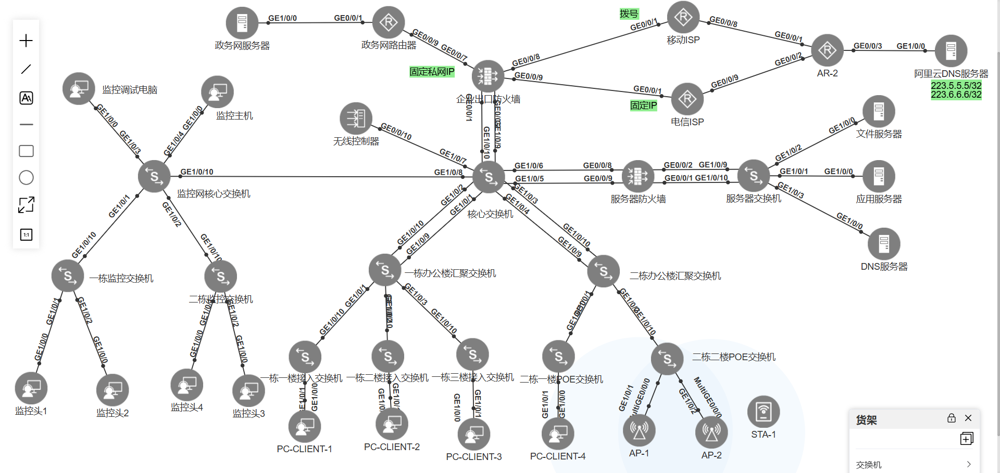

# 实验项目

## 实验编号：test20-02

## 实验目的：

- 张工安排的任务：

---

有一个企业网，属于国家事业单位，两根宽带一根是拨号的，给无线用户使用（包括无线办公员工、无线访客——这个网络是一个事业单位，来办理的业务的访客比较多），一根发布业务的应用服务器和有线终端电脑使用。办公电脑需要连接到政务网的服务器，需要把数据发给政务网服务器。

要求：
   1.有线电脑和服务器通过固定IP地址的宽带上互联网，无线访客和无线办公用户通过拨号的宽带上互联网。
   2.有线电脑和服务器需要访问政务网的服务器。
   3.由于向运营商申请的固定IP专线是100兆的，拨号是500兆的宽带。因此，在访客拨号的那根宽带上需要进行限速，只允许每个用户最大宽带不能超过10兆。固定专线的那根宽带，只允许有线办公电脑使用带宽加起来最多只能并发达到80兆，其余20兆留给服务器，以防止有线电脑占用过大带宽。
   4.无线访客允许上互联网，不允许访问公司任何资源和政务网任何资源。
   5.有线办公电脑和服务器从固定IP地址上互联网，一旦固定IP的外网带宽欠费或者被挖掘机挖断光纤了，导致外网不通，那就自动通过拨号的宽带上互联网以不影响办公。一旦固定IP的宽带恢复，则自动走固定IP地址上互联网。一旦拨号断开了，那么无线访客直接不能上网，不允许逃生到固定IP专线带宽去上互联网，而无线办公员工可以通过固定IP专线去上互联网。
   6.无线办公用户需要绑定MAC，否则无法连接办公无线SSID。访客只允许访问访客网无线SSID，不允许连接办公SSID。
   7.有线办公和无线办公用户都可以访问监控网，不允许监控网（包括监控主机）上互联网
   8.发布应用，将办公网的应用服务器的80端口发布到公网IP地址，18021端口。而为了能从家里或者其他外网能够方便维护观察监控头的状态，在外网通过19231端口映射到监控主机的3389远程桌面来查看监控头。项目初期，还未交付项目时期，为了修改网络设备比较方便，工程师可以做映射来方便在家里修改交换机端口、做配置等内容。可以临时配置允许把核心交换机的telnet端口和SSH登录、AC控制器的https登录web界面的端口映射到公网的21230端口、21222端口、34439端口。
   9.为了防止其他的一些网络层面的攻击，或者是访客的攻击。那么要限制一些端口，进行加固。限制135-139、1433、23333、23端口（因此，交换机的telnet端口要改一下）、80端口、3389端口（除了监控网的监控主机不用）。
   10.打印机、服务器、门禁（门禁和有线电脑一个网段）都是固定IP，有线办公、无线办公、无线访客都是DHCP。为了防止私接小路由器（就怕把小路由器的LAN口当做交换机使用，dhcp获取IP地址的时候，会部分电脑获取到小路由器的LAN口IP地址），需要对接入交换机配置，防止DHCP的攻击。
   11.应用限制，禁止员工在上班时间玩英雄联盟、抖音、快手、QQ飞车等游戏。
   12.安全机制：只允许网络某段IP地址能登录防火墙和接入交换机，用户上网互联网以及端口映射必须加上IPS、AV等安全模块的特征库匹配，以保障内网用户和服务器的安全。